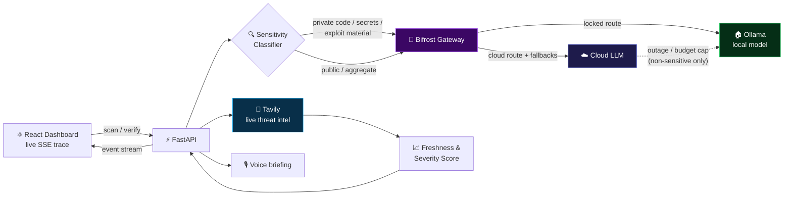
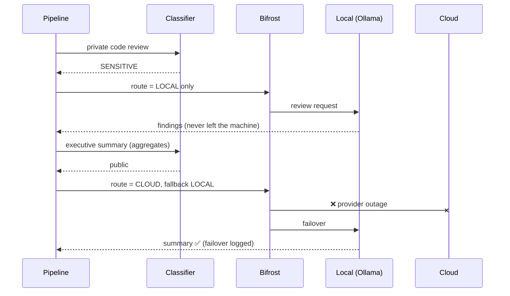

<div align="center">


<a href="https://github.com/YOUR_USERNAME/aegismind">
  
</a>

<br/>


**[🎥 Demo Video](YOUR_VIDEO_LINK)** · **[📐 Architecture](docs/architecture.md)** · **[🛡️ Security Scope](SECURITY.md)**

</div>

---

## 🎬 See it in action

<div align="center">

<!-- Record a 15-30s GIF of a real scan with a cloud failure injected, save as docs/assets/demo.gif -->


</div>

---

## ⚡ The problem

AI security tools have two failure modes:

1. **They leak.** Private source code and secrets get sent to cloud LLMs.
2. **They go stale.** They repeat advisories like *"CVE-XXXX has no patch"* long after a fix shipped.

AegisMind fixes both. Sensitive data is physically unable to reach a cloud model, and every advisory claim is re-verified against live web sources before anyone acts on it.

## 🧠 How it works

| Capability | What it does |
|---|---|
| 🔒 **Zero-trust routing** | A classifier tags every LLM call. Private code, secrets, and exploit material are locked to a **local Ollama model**. If the local model is down, the call **fails closed**. It never falls back to cloud. |
| 🌐 **Stale-claim verification** | Tavily searches trusted security sources, and each claim gets a verdict: `CONFIRMED`, `STALE_CONTRADICTED`, `REVOKED`, or `UNVERIFIABLE`, plus a transparent 0-100 **Freshness Score**. |
| 🛡️ **Gateway governance** | All model traffic goes through **Bifrost**: provider failover, budgets, rate limits, token tracking. |
| ♻️ **Resilience** | Per-route circuit breakers, retry with backoff, per-run and global spend caps, and a chaos switch to inject cloud failures live. |
| 📊 **Trace dashboard** | Live tool calls, route decisions, token usage, cost per run, and failover events. |
| 🎙️ **Voice war-room briefing** | A 60-second spoken executive summary built **only from aggregate results**, never from private code. |

## 🏗️ Architecture



### Failover behavior



## 🚦 Project status

| Component | Status |
|---|---|
| Sensitivity classifier + fail-closed routing | ✅ |
| Bifrost client (failover, breaker, budgets) | ✅ |
| Tavily stale-claim verification | ✅ |
| FastAPI endpoints + SSE trace stream | ✅ |
| React dashboard | 🚧 |
| Voice briefing (smallest.ai / Omnidimension) | 🚧 |
| Docker Compose one-command launch | 🚧 |

> Update this table as you ship. Never mark something ✅ that you haven't run end to end.

## 🚀 Quick start

**Prerequisites:** Python 3.11+, Node 20+, [Ollama](https://ollama.com), and API keys for Tavily plus one cloud provider.

```bash
# 1. Clone
git clone https://github.com/YOUR_USERNAME/aegismind.git && cd aegismind

# 2. Local model (sensitive traffic stays here)
ollama pull llama3.1:8b

# 3. Bifrost gateway (add your cloud key + Ollama provider in its UI at :8080)
npx -y @maximhq/bifrost

# 4. Configure
cp .env.example .env        # fill in TAVILY_API_KEY and BIFROST_VIRTUAL_KEY

# 5. Backend
cd backend && python -m venv .venv && source .venv/bin/activate
pip install -r requirements.txt
uvicorn app.main:app --reload --port 8000

# 6. Frontend (new terminal)
cd frontend && npm install && npm run dev
```

Open **http://localhost:5173**, pick `lab-01-flask-shop`, and press **Scan**.

## 🧪 Try the demo labs

| Lab | What it demonstrates |
|---|---|
| `lab-01-flask-shop` | Vulnerable Flask app + advisories claiming "no patch" that Tavily should contradict |
| `lab-02-yaml-api` | Unsafe YAML parsing + a mix of confirmed and stale advisories |

**Prove the zero-trust claim:** open the dashboard, set the chaos slider to 100%, and re-run a scan. The summary fails over to the local model, and the private code review never touches the cloud in either case.

```bash
# or from the terminal
curl -X POST localhost:8000/api/chaos -H 'content-type: application/json' \
  -d '{"cloud_failure_rate": 1.0}'
```

## 🔐 Security & scope

AegisMind is a **defensive** tool. Scans run only against the allowlisted labs in `demo_data/`. There is no live-target scanning and no exploit generation. Read [SECURITY.md](SECURITY.md).

## ⚠️ Known limitations

- Run state is in memory and is lost on restart.
- The Freshness Score is a transparent heuristic, not ground truth. Sources and reasoning are returned with every score.
- Fix-version detection is keyword-based and can misfire on unusual advisory wording.
- Bifrost budgets and rate limits are configured in Bifrost itself. The in-app spend tracker is a UI mirror.

## 🗺️ Roadmap

- [ ] LLM adjudication pass over Tavily evidence
- [ ] Persistent run storage
- [ ] Multi-lab batch scans
- [ ] Exportable incident reports

## 🤝 Built with

[Bifrost](https://github.com/maximhq/bifrost) · [Tavily](https://tavily.com) · [FastAPI](https://fastapi.tiangolo.com) · [React](https://react.dev) · [Ollama](https://ollama.com)

Built for the **Geek Room Global AI Hackathon** (hackCBS / HackCulture).

<div align="center">

**MIT License**


</div>
